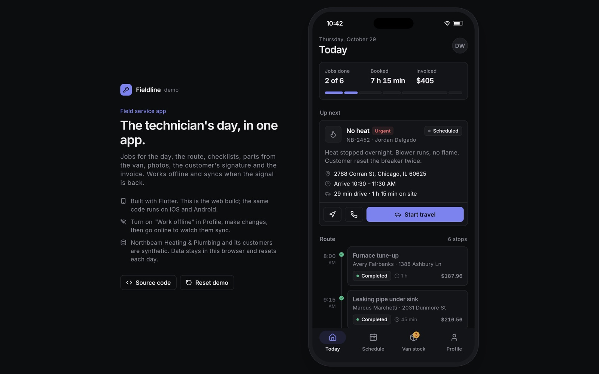
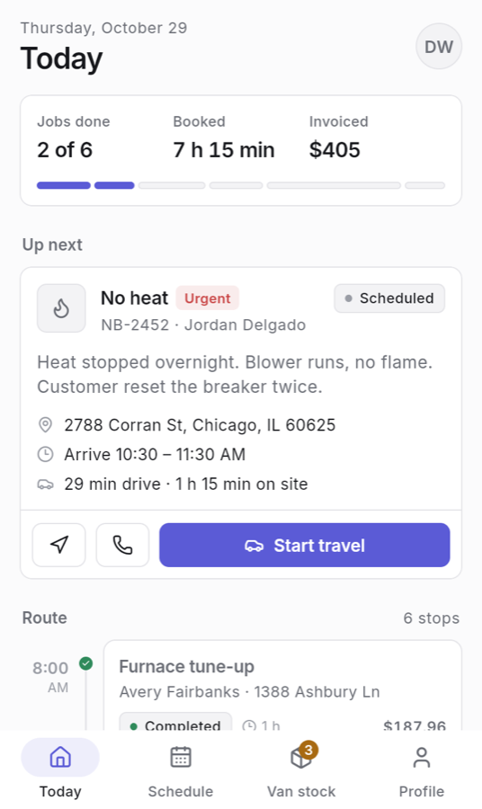
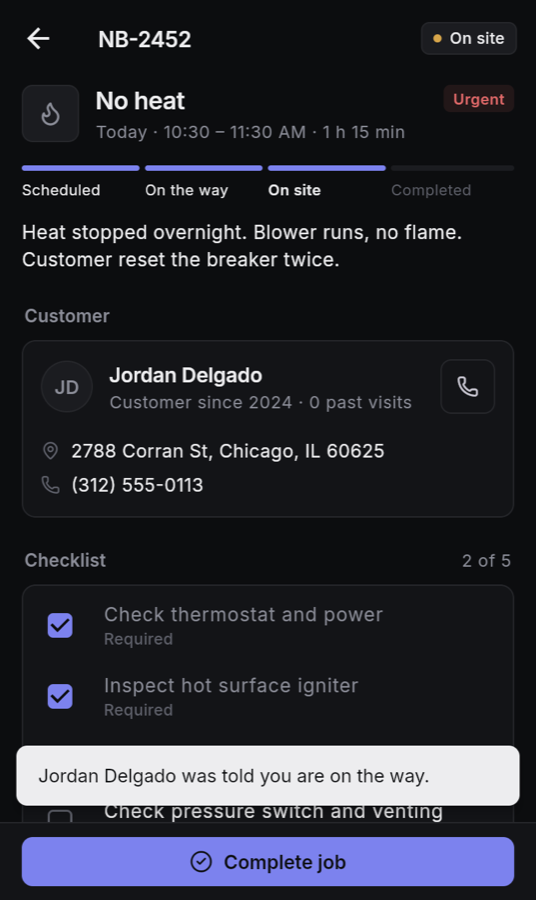
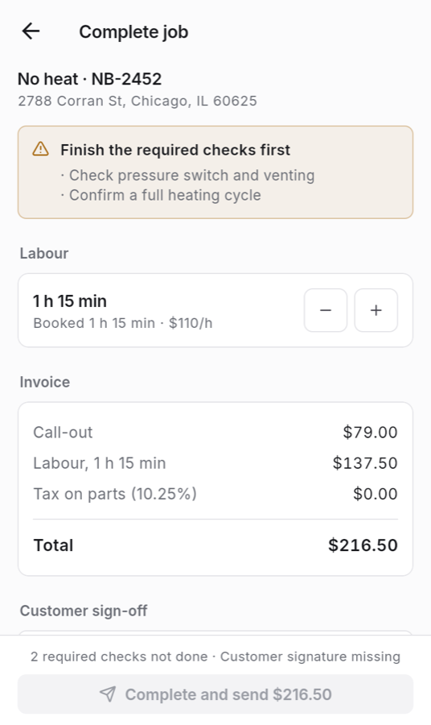
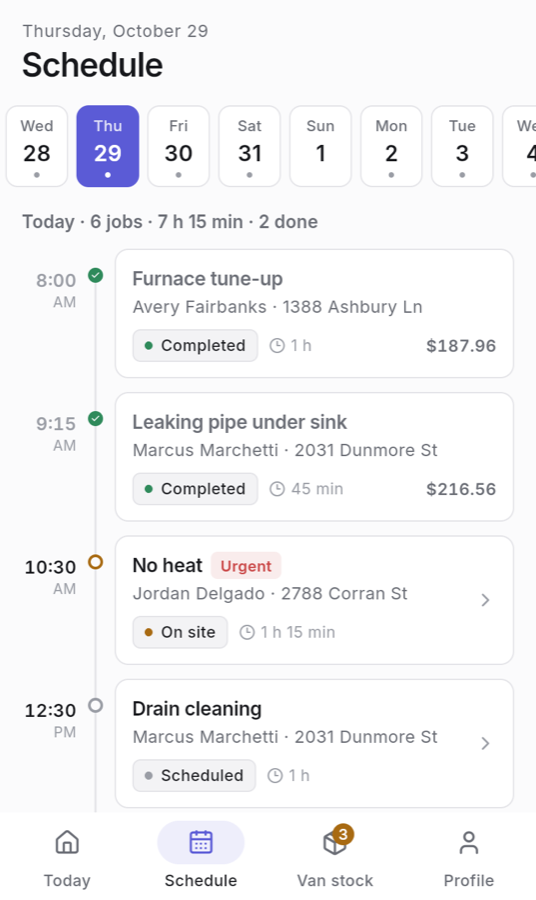
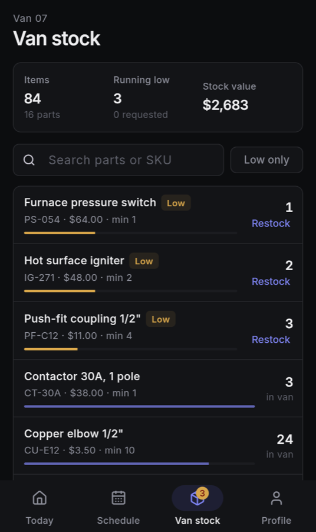
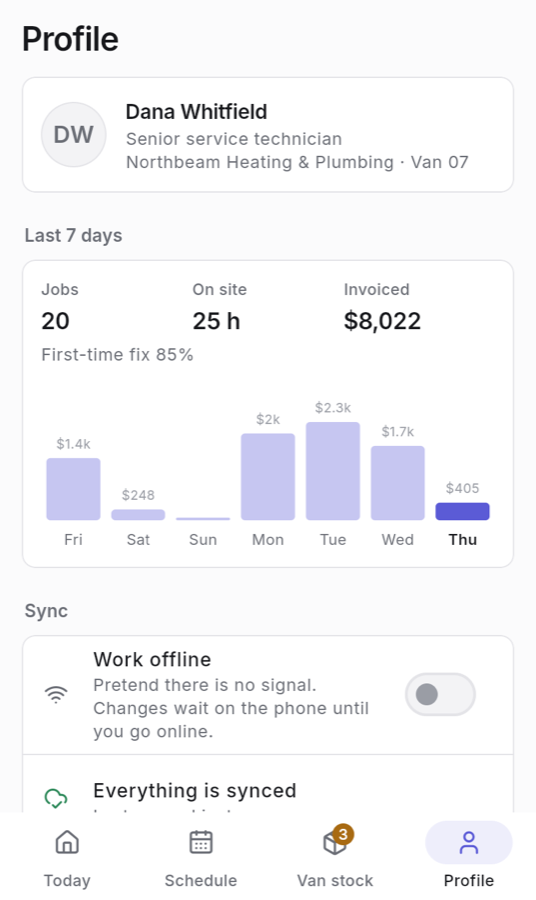

# Fieldline: Field Service App (Flutter)

A mobile app for service technicians: the day's jobs and route, checklists, parts taken from the van, photos,
the customer's signature and the invoice. It keeps working without signal and syncs the queued changes when the
connection is back.

**Live demo:** https://ozenyunus35.github.io/field-service-app/ (best on a phone; on a computer the app is shown
in a phone frame)



> **This is a demo.** Northbeam Heating & Plumbing is a fictional company in Chicago, and its technician,
> customers and jobs are synthetic (phone numbers are 555-01xx). There is no server: data is stored on the device
> (localStorage on the web) and regenerated around today's date each new day. Use **Reset demo data** in Profile
> to start over.

## Try it

1. On **Today**, the urgent "No heat" call is next. Tap **Start travel**, then **Arrived on site**.
2. Open the job, tick the required checks, add a part from the van and a photo.
3. Tap **Complete job**: adjust the labour time, check the invoice, sign with a finger or the mouse, and send it.
4. In **Profile**, turn on **Work offline**, make a few changes, then go online and watch them sync.
5. **Van stock** shows what is running low; request a restock.

## Features

- **Today:** progress for the day, the next or current job with address, arrival window, drive time and one
  primary action, and the route as a timeline.
- **Job flow:** scheduled → on the way → on site → completed. Required checklist items and the signature are
  enforced before sign-off; completed jobs become read only and show the invoice and signature.
- **Parts:** taken from the van's stock and returned with − / +, price kept at the time of use, out-of-stock
  handling, low-stock badges and restock requests.
- **Invoice:** call-out fee, labour in 15-minute steps (minimum 30), parts and sales tax on parts.
- **Offline mode:** every change is saved on the device first; while offline it joins a queue that syncs when the
  connection returns, with the status shown on every screen.
- **Schedule:** two weeks of days with job counts; **Profile:** last 7 days (jobs, hours, invoiced, first-time fix
  rate) with a chart, sync status, light / dark / system theme.
- Accessible: semantic labels for every control, so screen readers (and the browser tests) can use the app.

| Today | Job | Sign-off |
| --- | --- | --- |
|  |  |  |
| **Schedule** | **Van stock** | **Profile** |
|  |  |  |

## How it is built

- `lib/src/store.dart`: the app state (a `ChangeNotifier`) with every business rule: job status flow, checklist
  and signature checks, stock moves, invoice maths, the offline queue and sync, persistence with
  `shared_preferences`.
- `lib/src/seed.dart`: deterministic synthetic data for the day (same day, same data), with a fixed route for
  today so the first screen always tells the same story.
- `lib/src/screens/`: Today, Schedule, Van stock, Profile, job detail, sign-off with a signature pad drawn on a
  `CustomPainter`.
- `lib/src/theme.dart`: design tokens for light and dark (neutral greys, one indigo accent, Inter).

### In production

| Demo | Production |
| --- | --- |
| Data on the device, a simulated sync | A REST or GraphQL API (or Firebase / Supabase), a local database (Drift / SQLite) and a background sync with conflict handling |
| Photos drawn as placeholders | Camera and gallery with `image_picker`, compressed uploads to S3 or Cloud Storage |
| Directions and calls show a note | `url_launcher` for maps and phone, live location with `geolocator` |
| Invoice shown in the app | PDF invoice emailed to the customer, payment with Stripe |
| One technician | Sign-in, dispatcher web dashboard, push notifications for new and changed jobs |

## Run it

```bash
flutter pub get
flutter run                 # on a simulator or device
flutter test                # unit and widget tests
flutter build web --release --base-href /field-service-app/ --no-web-resources-cdn
```

Browser tests run against the web build, served under `/field-service-app/` like on GitHub Pages:

```bash
cd e2e
npm install
npx playwright install chromium webkit
npx playwright test        # desktop Chrome, desktop Safari (WebKit), iPhone, Android
BASE_URL=https://ozenyunus35.github.io/field-service-app/ npx playwright test   # against the live site
```

## Tests

- **Unit (Dart):** seed determinism and integrity (no overlaps, working hours, synthetic contacts), the job
  flow, sign-off rules, stock moves and out-of-stock, invoice and labour rounding, the offline queue and sync,
  persistence across restarts, re-seeding on a new day, corrupt storage, stats and formatting.
- **Widget:** the first screen, starting travel, the whole job from travel to signed invoice, blocked sign-off,
  van stock filter and restock, schedule, offline queue and sync, theme and reset, the wide phone-frame layout,
  read-only completed jobs.
- **End-to-end (Playwright, clock pinned to a Thursday morning in Chicago):** the same flows in real browsers
  through the app's accessibility tree, on four browser/device profiles.

GitHub Actions checks formatting, runs the analyzer, unit, widget and browser tests on every push to `main`, then
deploys the web build to GitHub Pages.

## Tech

Flutter 3.47 (Dart 3.13), Material 3 with a custom theme, `shared_preferences`, Lucide icons, Inter, Playwright.
MIT License.
